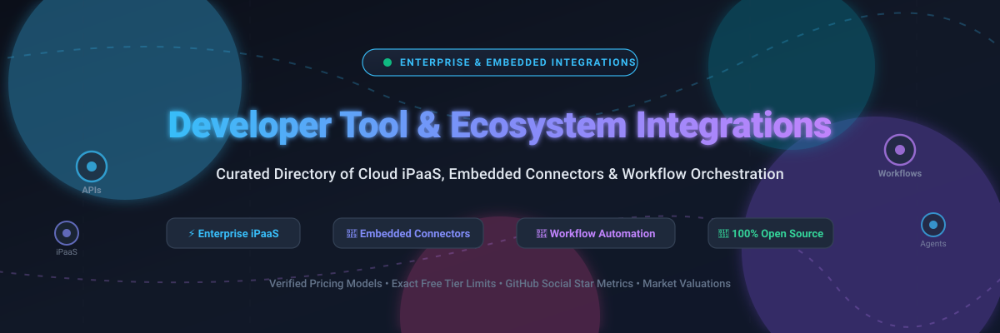

  

# 🌐 Awesome Ecosystem & Developer Tool Integrations 🚀

  <strong>The definitive curated list of enterprise iPaaS, embedded integration platforms, and open-source workflow automation engines.</strong>

  
  
  
  
  
  

  <em>Last updated: March 2026 • Curated for integration architects, platform engineers, and B2B SaaS builders</em>

---

## 📖 Overview

Welcome to the **Awesome Ecosystem & Developer Tool Integrations** repository! This project serves as an authoritative, community-vetted hub tracking top **SaaS platforms** and **open-source frameworks** across:

- ⚡ **Enterprise iPaaS (Integration Platform as a Service)**: High-throughput API-led integration, data transformation, and governance (e.g., MuleSoft, Boomi, Workato).
- 🧩 **Embedded Integration Platforms (Embedded iPaaS)**: Native connectors, white-labeled integration marketplaces, and customer tenant management for SaaS products (e.g., Prismatic, Terapi).
- 🔄 **Workflow & Event Automation**: Event-driven orchestration, visual DAG builders, and trigger-action pipelines (e.g., Zapier, n8n, Activepieces).
- 🤖 **Agentic & Developer Orchestration**: Code-first durable execution, LLM-native agents, and microservice integration (e.g., Temporal, Kestra, Windmill).

Whether you are looking to eliminate costly per-row/per-tenant SaaS licensing with self-hosted solutions or architect enterprise data synchronization, this guide provides verified pricing, free tier parameters, company valuations, and repository star metrics.

---

## 📑 Table of Contents

- [📊 Sector Overview & Market Dynamics](#-sector-overview--market-dynamics)
- [☁️ SaaS/Hosted Platforms](#️-saashosted-platforms)
- [🌱 Open-Source GitHub Projects](#-open-source-github-projects)
- [📈 Star History](#-star-history)
- [🤝 How to Contribute](#-how-to-contribute)
- [💖 Support & Sponsorship](#-support--sponsorship)
- [⚖️ Disclaimer](#️-disclaimer)

---

## 📊 Sector Overview & Market Dynamics

The global Integration Platform as a Service (iPaaS) and developer integration sector is valued at approximately **$8.5B to $10B+**, growing rapidly at an estimated **20–23% CAGR** driven by cloud API proliferation, hybrid architectures, and autonomous AI agents. The sector exhibits a **barbell dynamic**: highly concentrated at the enterprise top tier where dominant legacy giants capture major enterprise IT spend, yet moderately fragmented across a long tail of 150+ specialized vendors catering to embedded SaaS, developer-first workflows, and low-code integrations.

---

## ☁️ SaaS/Hosted Platforms

| Product | Description | Valuation / Revenue | Pricing (Starting) | Free Tier / Trial Limits |
|---|---|---|---|---|
| **[MuleSoft](https://www.mulesoft.com/)** 🏢 | Enterprise-grade iPaaS and API management (Salesforce) delivering full-lifecycle API governance, ESB capabilities, and complex multi-cloud enterprise connectivity. | **$6.5B acquisition valuation** (~$297M+ TTM revenue at acquisition) | **$2,000/month** ($24,000/year billed annually) for entry packages; enterprise vCore models scale from ~$1,250–$1,750/vCore/month | **30-day free trial** with access to Anypoint Platform, Design Center, and Exchange |
| **[Workato](https://www.workato.com/)** ⚡ | Enterprise low-code workflow automation and iPaaS platform using recipe-based triggers and a Connector SDK to integrate IT, HR, and revenue tech stacks. | **$5.7B valuation** (Series E) / ~$150M ARR | **$75/month** for Pro tier (includes 2,500 credits/month); base platform fees apply for enterprise packages | **Free tier available**: 50,000 one-time starter credits (never expire) for community recipes and custom connectors |
| **[Zapier](https://zapier.com/)** 🔗 | Universal no-code automation platform with 7,000+ app connectors, AI orchestration, and multi-step conditional workflows. | **$5.0B valuation** / ~$310M ARR | **$19.99/month** (billed annually at $239.88/year) for Professional plan (750 tasks/month) | **Free plan**: 100 tasks/month, 2-step single-trigger Zaps, unlimited free zaps; **14-day free trial** of Professional plan with 1,000 tasks |
| **[Boomi](https://www.boomi.com/)** 🌐 | Cloud-native enterprise iPaaS featuring Atom runtime architecture, unified API control plane, EDI/B2B management, and master data management. | **$4.0B buyout valuation** (Francisco Partners & TPG) / ~$500M+ ARR | **$99/month** base fee + $0.05 per processed Boomi Message (Pay-As-You-Go self-service tier) | **30-day free trial** with full platform capabilities, unlimited connectors, and test Atom runtimes |
| **[Tray.io (Tray.ai)](https://tray.ai/)** 🤖 | Low-code integration platform and autonomous Merlin AI Agent builder designed for hyper-automation across complex business logic and CRM/ERP systems. | **$600M valuation** (Series C) / ~$70M ARR | **$500/month** (approx. starting tier equivalent, billed annually from ~$18,000/year for Pro tier) | **14-day free trial** with access to workflow builder and select standard connectors |
| **[Celigo](https://www.celigo.com/)** 📦 | Business process iPaaS optimized for ERP, CRM, and eCommerce ecosystems (notably NetSuite, Salesforce, Shopify) with prebuilt application integration flows. | **$250M+ valuation** / ~$95M ARR | **$500/month** (~$6,000 to $14,787/year standard entry based on active endpoints and flows) | **Free plan**: 1 active flow and 2 endpoints (never expires); **30-day free trial** with unlimited flows and enterprise connectors |
| **[Prismatic](https://prismatic.io/)** 🧩 | Embedded iPaaS purpose-built for B2B SaaS teams to design, white-label, deploy, and monitor native integrations directly within customer-facing applications. | **$150M+ estimated valuation** ($44M+ funding raised) | **$1,500/month** (billed annually from ~$18,000/year for Scale tier) | **14-day free trial** of the Scale platform with sandbox tenant environments and SDK access |

---

## 🌱 Open-Source GitHub Projects

| Project | Stars_Badge | Description |
|---|---|---|
| **[n8n](https://github.com/n8n-io/n8n)** 🪢 |  | **Fair-code visual workflow automation platform.** Connects 400+ services and LLMs with self-hostable Docker deployment, visual branching, and webhook triggers. The leading open-source Zapier/Make alternative. |
| **[Huginn](https://github.com/huginn/huginn)** 🦅 |  | **Lightweight agent system for automated event monitoring and tasks.** Built in Ruby, allowing developers to create custom agents that monitor web pages, trigger webhooks, and scrape APIs like a self-hosted Yahoo! Pipes. |
| **[Kestra](https://github.com/kestra-io/kestra)** ⚙️ |  | **Declarative, event-driven orchestrator.** Manages complex data pipelines and internal developer integrations via YAML flow definitions with built-in UI, metrics, and microservices connectivity. |
| **[Activepieces](https://github.com/activepieces/activepieces)** 🧩 |  | **Open-source business and developer workflow automation.** Designed with an intuitive React UI, TypeScript framework for authoring custom "pieces" (connectors), and enterprise-ready self-hosting. |
| **[Temporal](https://github.com/temporalio/temporal)** ⏱️ |  | **Durable code-as-configuration workflow orchestration engine.** Ensures fault-tolerant execution of microservice integrations, API retries, and distributed transactions across polyglot SDKs (Go, TypeScript, Python, Java). |
| **[Node-RED](https://github.com/node-red/node-red)** 🔴 |  | **Low-code event-driven integration tool.** Browser-based flow editor built on Node.js, widely used for IoT, hardware APIs, webhooks, and edge developer automation. |
| **[Airbyte](https://github.com/airbytehq/airbyte)** 🪣 |  | **Open-source ELT data integration platform.** Features 350+ pre-built connectors and a connector builder for syncing data between SaaS applications, databases, and data warehouses. |
| **[Windmill](https://github.com/windmill-labs/windmill)** 💨 |  | **Fast, developer-centric workflow and script orchestrator.** Open-source alternative to Retool and Temporal for turning Python, TypeScript, Go, and Bash scripts into auto-generated endpoints, workflows, and UIs. |
| **[Apache Camel](https://github.com/apache/camel)** 🐪 |  | **Battle-tested enterprise integration framework.** Implements enterprise integration patterns (EIP) with hundreds of components for Kafka, JMS, HTTP, cloud services, and legacy enterprise software. |
| **[Cenit IO](https://github.com/cenit-io/cenit)** 💎 |  | **100% open-source enterprise iPaaS.** Complete self-hosted integration platform in Ruby with React UI, multi-tenant data sync, transformation pipelines, and native Odoo ERP connectors. |
| **[MEL Agent](https://github.com/cedricziel/mel-agent)** 🧠 |  | **AI-native visual workflow automation engine.** Built with Go and React, offering visual node graphs, LLM embeddings, integration nodes, real-time trace inspection, and horizontal worker scaling. |
| **[Terapi](https://github.com/api-evangelist/terapi)** 🔌 |  | **Open-source embedded iPaaS framework.** Self-hosted toolkit for B2B SaaS teams to embed third-party app connectors, manage end-user authentication, and power customer integrations without per-tenant fees. |

---

## 📈 Star History

---

## 🤝 How to Contribute

We welcome contributions from integration architects, developers, and open-source maintainers! 🌟

1. 🍴 **Fork the repository**.
2. 🌿 **Create a branch**: `git checkout -b feature/add-new-tool`
3. ✏️ **Add/edit entries in [README.md](file:///C:/Users/ishan/Documents/Projects/Awesome-Ecosystem-Developer-Tool-Integrations/README.md)** (maintain table schemas, accurate verified pricing, free tier limits, and badges).
4. 📝 **Commit your changes**: `git commit -m "Add [Tool Name] to Developer Tool Integrations"`
5. 🚀 **Submit a Pull Request** with a concise description of the product or project.

---

## 💖 Support & Sponsorship

If you find this repository helpful for your projects, research, or architecture decisions, please consider supporting the project:

- ⭐ **Star this repository** on GitHub to help others discover it!
- 🍴 **Fork and share** it with your developer community and platform teams.
- ☕ **Buy a coffee & sponsor**: You can support ongoing maintenance via the [GitHub Sponsors Dashboard](https://github.com/sponsors/ishandutta2007).

Thank you for being part of the open-source community! 🙌

---

## ⚖️ Disclaimer

- This is a **community-curated list** — not an exhaustive directory or commercial endorsement.
- Integration platforms handle sensitive OAuth tokens, API credentials, and critical business data flowing between systems; enforce least-privilege scopes, secret rotation, and audit logging for all connector activity.
- **Pricing models in this category vary dramatically.** Enterprise iPaaS solutions use credit-based or vCore pricing scaling with task volume. Embedded integration platforms frequently utilize per-active-tenant or connector licensing. Open-source solutions eliminate recurring SaaS fees but require infrastructure provisioning and operational management.

---

**Made with ❤️ for integration engineers, platform teams, and SaaS builders shipping developer-facing integrations.**  
Let's make ecosystem and developer tool integrations more open, predictable, and product-native.

